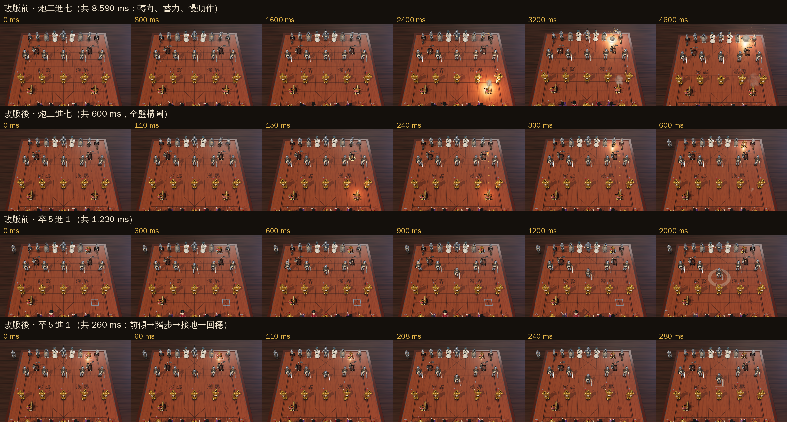
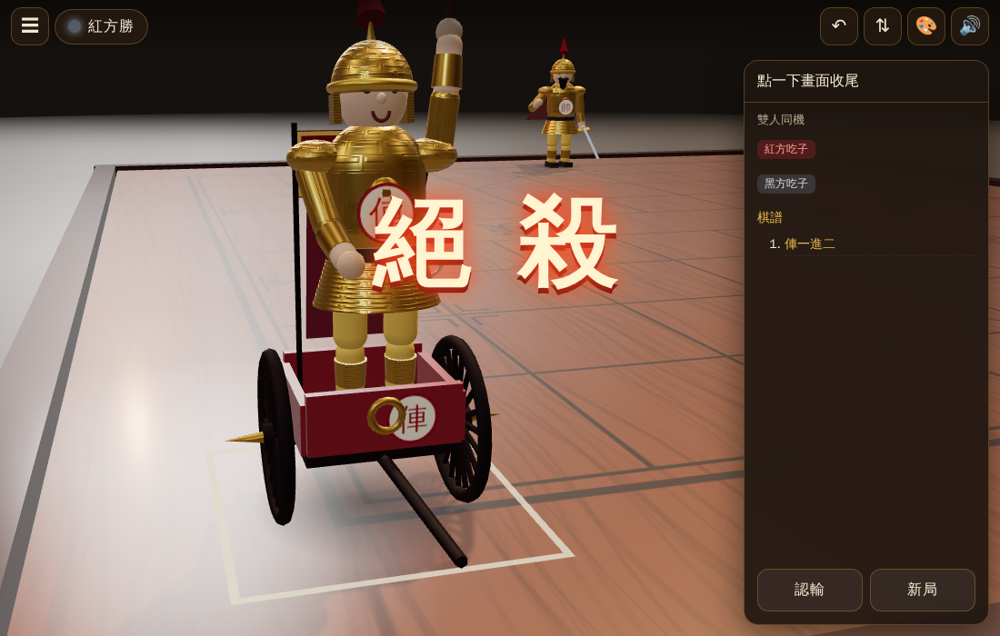
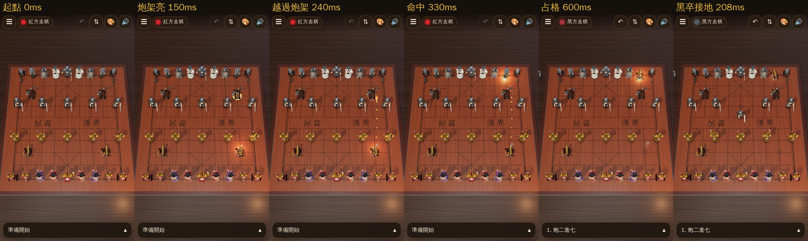

# 改版第一輪：兩步原型（炮二進七 → 卒５進１）

試玩：開啟網站加上 `?lab=1`，或在首頁選「🧪 改版原型對照」。面板可切換「改版前／改版後」、三種強度，並調整時間起始值。

## 實測時長（逐格時鐘量測）

| 動作 | 改版前 | 改版後 | 目標 |
|---|---|---|---|
| 炮二進七（炮越過黑砲吃黑馬） | 8,590 ms | 600 ms | 600 ms |
| 卒５進１ | 1,230 ms | 260 ms | 220–300 ms |

## 炮吃馬時間軸（標準強度，起始值）

| 時間 | 畫面 | 聲音 |
|---|---|---|
| 0–110 ms | 紅炮壓低炮身、炮口微抬 | 45 ms 短機括 |
| 100–260 ms | 炮架（黑砲）底座亮一拍 | — |
| 150–330 ms | 發光砲彈帶拖尾，短弧越過炮架 | — |
| 330 ms | 命中黑馬 | 厚實撞擊 |
| 330–570 ms | 黑馬後仰、下沉、淡出退場 | — |
| 380–580 ms | 紅炮加速、煞停，進占目標格 | — |
| 580 ms | 落地，留下細框 | 輕木質落盤 |

炮吃子兼將軍時，印記與短鼓接在落地這一拍（+30 ms），不另起一段演出。

## 黑卒一步（260 ms）

0–60 ms 重心前傾（不移動）→ 60–208 ms 跨出一步 → 208 ms 接地（腳步聲、肩甲受力）→ 208–260 ms 上身回穩，肩甲以阻尼彈簧再晃約 0.3 秒。

## 聲音

- 聲音由時間軸事件觸發，提前 120 ms 排進音訊時鐘，並用 `getOutputTimestamp()` 扣掉輸出延遲，讓聲音到達喇叭的時間對準畫面。
- 機括、撞擊、落盤、腳步、短鼓、馬蹄都各有 3 個變體，連續兩次不重複（200 次抽樣驗證）。
- 模擬手機喇叭（濾掉 350 Hz 以下）並調到小音量：吃子三聲的峰值比普通步高約 13 dB、總能量高約 19 dB。

## 三種強度

- **快速**：時長 ×0.82（一步不低於 220 ms），不加粒子。
- **標準**：鏡頭不動，維持全盤構圖；將軍時將帥腳下浮出「將軍」印記，配一記短鼓。
- **電影**：吃子同樣是全盤構圖，只多一點煙塵和輕微震動；將殺時給英雄特寫，點一下畫面收尾。

## 手機直向

## 已知限制

- 測試環境沒有顯示卡（約 1–2 fps），所以「畫面對聲音 ±50 ms」這一項只驗證了排程邏輯，沒有在真機上量測。請用手機開 `?lab=1`，看面板上的偏差數字（綠色代表在 50 ms 內）。
- 車（直線加速、煞停）、馬（蹬地、前後蹄兩拍落地）、象（沉重兩步）已經套用同一套節奏，但時間還沒調整，只是能玩的起始版本。
