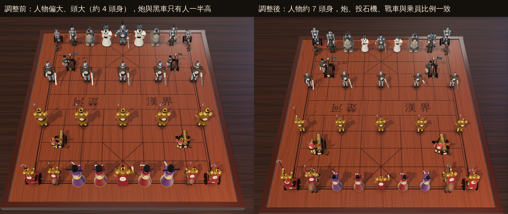
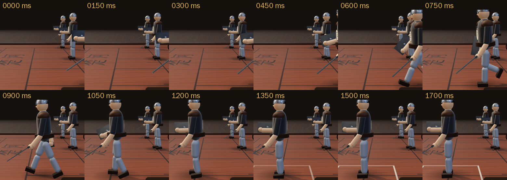
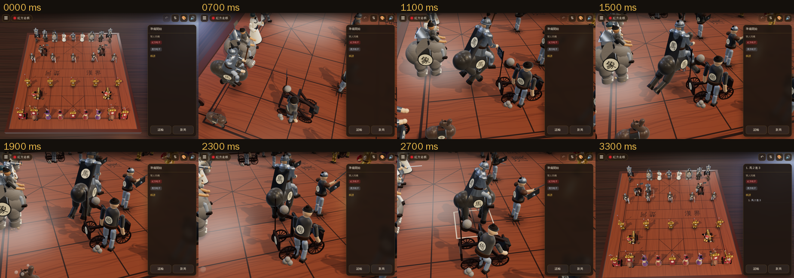
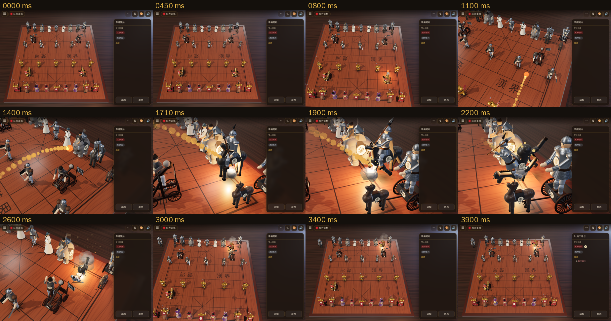
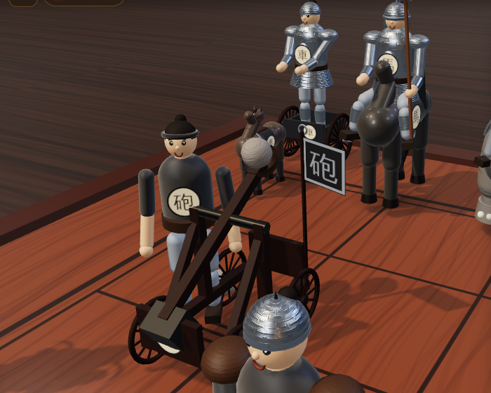
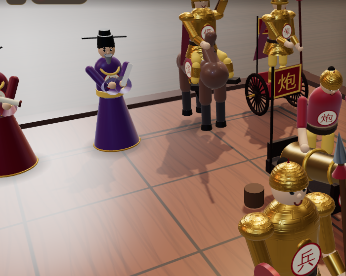

# 改版第二版：放慢節奏、真人行走、駿馬奔馳、比例協調

試玩：網站加上 `?lab=1`，面板預設為「第二版」＋「電影」強度；也可以切回「改版前」「第一版」對照。

## 這一版改了什麼

1. **人物比例**：從約 4 頭身改成約 7 頭身（頭縮小、腿和手臂加長），人物在棋盤上約 1.1 格高。
2. **器械與坐騎放大**：紅炮、黑砲（投石機）、俥、車、騎兵、戰象全部重新換算尺寸；砲手、裝填手、車夫、騎士的實際身高與單獨站立的人物相同。
3. **真人走路**：一格走兩步，每步約 0.5 秒。腳跟著地 → 單腳支撐 → 腳尖離地；擺動期屈膝、骨盆左右下沉、肩膀與骨盆反向扭轉、雙手反向擺動、頭部保持穩定。起步先轉移重心，收步時雙腳併攏。
4. **駿馬奔馳**：先蓄勢（後腿下沉、昂首），再慢速奔馳；中段空中慢動作，四拍馬蹄聲，前蹄、後蹄兩拍落地。電影強度時鏡頭從斜上方跟拍，結束後回到全盤。
5. **電影感**：炮吃子時，砲彈在弧頂減速，鏡頭側拍追著砲彈，命中瞬間全場慢動作（其他棋子與粒子以 ×0.35 速度播放），被吃的棋子先被擊退、膝蓋一軟，再往後倒下淡出。
6. **全面放慢**：象的沉重緩步、戰車加速與煞停揚塵、所有待機動作都放慢約 1.45 倍。
7. **繁體中文**：程式註解、說明文件全部改為繁體中文。

## 實測時長（逐格時鐘量測，電影強度）

| 動作 | 第一版 | 第二版 |
|---|---|---|
| 卒５進１（真人行走兩步） | 260 ms | 1,640 ms |
| 黑馬奔馳（馬２進３） | 約 440 ms | 3,300 ms |
| 炮二進七（炮吃馬） | 600 ms | 3,450 ms |

面板的「手感調整」可以即時調整：真人每步秒數、駿馬奔馳段長度、慢動作倍率。

## 對照圖

比例調整前後：

真人步態（側面近拍，每 150 毫秒一格）：

駿馬奔馳（電影強度，跟拍鏡頭）：

炮吃馬（電影強度）：

近拍比例：

 

## 已知限制

- 目前的棋子裡沒有獅子（早期的動物主題已經換成依字義塑造的人物），所以「獅子的動作慢一點」這一點，是用「所有角色的動作都放慢」來處理的。
- 電影強度下，馬和炮的鏡頭會移動。如果覺得一般對局太常切鏡頭，可以選「標準」強度：節奏同樣放慢，但鏡頭不動。
- 測試環境沒有顯示卡，只能逐格截圖驗證，流暢度與聲音節奏請在真機上確認。
